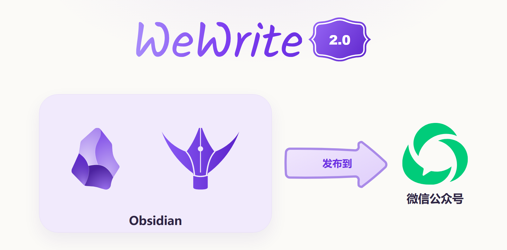

**English** | [简体中文](README_zh.md)

# WeWrite — Obsidian Plugin for WeChat Official Accounts

**Write in Obsidian, render to WeChat format in one click, and push straight to your WeChat drafts. It runs on every platform, so you can go from writing to publishing on your phone.**

  
  
  

WeWrite is a community plugin. It is not affiliated with or representative of Obsidian / Dynalist Inc. All product names and logos are the property of their respective owners.

  

---

## Why WeWrite 2.0

- **Runs the same everywhere.** Desktop and mobile have identical features, and every button is at least 44px. The cover editor supports pinch-to-zoom and drag.
- **No CSS files.** WeWrite renders through Obsidian and inlines every style into the HTML at publish time, so WeChat cannot strip your formatting.
- **Your data stays yours.** Images go straight into your Official Account's media library, never through a third party. WeWrite only ever publishes to drafts, and the final send is yours to approve.
- **Themes are notes.** A theme is a Markdown note with `wewrite_theme: true`. Start from a built-in template, then adjust it in a theme editor that previews changes live.
- **100+ decorations.** Headings, blockquotes, code blocks (12 color themes), tables, lists, dividers, links, math, diagrams and more, each configurable on its own.
- **Republishing is much faster.** Every image is fingerprinted with FNV1a-64, so anything you have already uploaded is skipped, even after a rename or a move. On a republish that saves 90%+ of the time.
- **A three-zone cover editor.** Pick any ratio for the main cover, and optionally add a 2.35:1 landscape and a 1:1 square. One click on **Compose** merges them into the multi-ratio crops WeChat asks for. All three support pinch-to-zoom, dragging and cropping, and AI can generate any of them.
- **AI writing tools built in.** Proofreading, synonyms, translation, Mermaid and formula generation, image generation and summaries, without leaving Obsidian.

---

## Features

### Markdown Rendering

The everyday syntax is all here:

- Headings H1–H6, bold, italic, strikethrough and inline code
- Code blocks with dark or light color themes, line numbers and macOS traffic-light decorations
- Ordered and unordered lists, task lists, tables, blockquotes, callouts, horizontal rules, footnotes and external links

On top of that: LaTeX math (rendered as MathJax SVG), Mermaid diagrams, Excalidraw sketches, wiki-link note embeds, and the inline icons that Obsidian, Iconize and Remix insert into a note.

**PDF embeds.** PDF++ region screenshots (`![[file.pdf#page=N&rect=x1,y1,x2,y2|caption]]`) and whole-page embeds (`![[file.pdf#page=N]]`) are rendered as PNGs and cached when you publish. This runs on Obsidian's built-in PDF.js, so there is nothing extra to install.

**Dataview.** `dataview` and `dataviewjs` code blocks, plus inline `$= ...`, are evaluated through the Dataview plugin and rendered as themed text, the same as hand-written Markdown.

**Images and tables.** An image with no size fills the reading column at its own pixel ratio, so a wide screenshot stays readable on a phone without resizing it by hand. An image you sized yourself (`![[photo.png|200x150]]`) keeps the size you gave it. Tables size to their content: a narrow one is centered instead of hugging the left edge, and a wide one scrolls sideways inside the article rather than squeezing its columns and breaking English words in half.

### Note Editing & AI Writing Assistant

Every action is available from four places: the **command palette**, the editor's right-click **"WeWrite" submenu**, the note header's **"⋮" menu**, and the **mobile editor toolbar**.

**Inserting images**

| Action | Description |
|--------|-------------|
| Insert Image from Vault | A thumbnail grid of every image in the vault, with a folder dropdown and a filename filter. Obsidian's own attachment picker only lists bare file names, which stops being usable once a vault has many images. |
| Insert Image from System | The device's own photo picker, which is the camera roll on a phone. The image is copied into the vault first, into the folder named by your *Default location for new attachments* setting, and converted to PNG if its format is one Obsidian cannot display. |

**AI writing tools**

| Feature | Description |
|---------|-------------|
| Proofread | Spelling, grammar and punctuation checks for Chinese and English. Results come back as a list you scan before deciding anything. Each correction is color-coded by severity (spelling and punctuation red, grammar orange, wording blue), and clicking one jumps to it. Only the characters that actually change are marked in your text, and you can rewrite a suggestion before accepting it. Accept or ignore one at a time, or all the remaining ones of a single type. `←`/`→` navigate and `Enter` accepts. With text selected the check runs on the selection, otherwise on the whole note. Code, frontmatter, links and `$math$` are withheld from the model, so they never come back as "corrections". |
| Synonyms | Alternatives for the selected word, chosen against the sentence it sits in. Each option shows its sense and a usage note, and the list can be re-rolled in place. |
| Translate | 10 target languages. Code, links, math and tags are protected from translation, and a result that lost one of them is flagged before it replaces your text. |
| Generate Mermaid | Description → an Obsidian-compatible diagram. You pick the diagram type instead of letting the model guess, and the source is syntax-checked before insertion (and repaired once if it fails). |
| Generate Formula | Description → LaTeX, block or inline. It is compiled with Obsidian's own MathJax before insertion. |
| Generate Image | Text description → AI illustration, inserted at the cursor. |
| Generate Summary | WeChat-compliant summaries generated in the article view. |

**AI text providers:** OpenAI / OpenAI Compatible (DeepSeek, Qwen, etc.) / Anthropic / Gemini / Ollama (local) / OpenRouter.

**Image generation providers:** Alibaba Wan 2.6 / Alibaba Qwen-Image 3.0 / ByteDance Seedream 5.0 / OpenAI DALL·E (the two Alibaba providers also need a Workspace ID).

**Automatic size fitting:** type any free-form size (`1440*613`, `2K`, `1024x1024`, …) and WeWrite converts it to the constraints each model actually enforces. Seedream, for example, wants at least 2560×1440 total pixels with width and height as multiples of 64. WeChat banner ratios therefore work out of the box.

### Publishing Workflow

Write → live preview in the WeWrite article view → set the title, author, summary and cover → push to drafts in one click → confirm and send from the Official Accounts Assistant app on your phone.

### Image Posts (NewsPic)

A dedicated view for image posts: up to 20 images with captions, drag-and-drop sorting, a phone-frame swipe preview, and cropping.

### Material Management

Images, article drafts and image drafts each get their own tab. From there you can sync, delete, download to the vault, copy a CDN link or set an image as the cover. Assets that published articles still reference are flagged automatically, so they are harder to delete by accident.

### Theme System

A theme is a Markdown note with `wewrite_theme: true`, stored in `wewrite/themes/`. The ten built-in presets (Minimal GitHub, Classic WeChat, Elegant Serif, Paper Long-form, Grid Document, Typography Aesthetic, Clean Media, Colorful Accents, Warm Daily and Dark Tech) are written on the same theme system as the ten downloadable ones. A built-in theme therefore styles every element, including headings, quotes, callouts, tables, dividers, lists, inline marks, images, formulas, Mermaid and Excalidraw, instead of only the handful the old presets knew about. A wizard sets up a theme in one dialog, and the visual editor covers the 100+ decorations and their parameters.

Two settings work at the **theme level** rather than per decoration, so one value reaches every element of that kind:

- **Vertical spacing:** one margin per block family (quotes, callouts, tables, code blocks, formulas, Mermaid diagrams, Excalidraw frames and images). A dense technical note gets a rhythm of its own instead of inheriting each block's built-in spacing.
- **Image window:** when it is on, images with no blank line between them merge into one swipeable horizontal row, which shortens an image-heavy article. A blank line still starts a new row. Off by default, and on for half of the built-in and half of the downloadable themes.

Ten themes ship with the plugin and ten more are downloadable, all written the same way, so a theme you build yourself is the same kind of object. **[Contributing a theme](CONTRIBUTING.md)** takes a single Markdown note and no build step, and it reaches every user as soon as it merges.

### Multi-Device Sync (Experimental)

Built-in WebDAV sync. Share one vault across devices, resolve conflicts in a visual dialog, and roll back through the sync journal. It is quota-aware for Jianguoyun's free plan, pausing and resuming automatically and putting notes first.

### Settings Import / Export

Export all settings as JSON (with a version number) to migrate between vaults. On first launch the plugin detects legacy v1.x settings and offers a one-click migration.

---

## Installation

> Requires **Obsidian 1.6.6 or later**. The plugin calls `FileManager.trashFile`, an API introduced in 1.6.6, so older builds cannot run it. Language detection uses `getLanguage()` (API 1.8.7) behind a `requireApiVersion` guard and falls back to English on 1.6.6–1.8.6.

Search for **"WeWrite"** in the Obsidian Community Plugins marketplace, then install and enable it.

Or install manually:

1. Download the latest release from [Releases](https://github.com/learnerchen-forever/wewrite/releases)
2. Extract it to `<vault>/.obsidian/plugins/wewrite/`
3. Restart Obsidian and enable the plugin in settings

---

## Quick Start

1. Configure your WeChat Official Account **AppID / AppSecret** in the plugin settings (add the IP to the whitelist, or enable "Use central token server")
2. Open any Markdown note and **right-click → "Open as WeChat Article"**
3. Fill in the title, author and summary in the parameter panel, or let AI generate them
4. Pick a theme preset and check the preview
5. Click **"Publish to Drafts"**
6. Open the Official Accounts Assistant app on your phone, go to drafts, and confirm the send

> For step-by-step details and FAQs, see the [Tutorials](#tutorials) below.

---

## Tutorials

- [Tutorial 1: Quick Start — From Note to WeChat Draft](tutorials/01-quickstart.md)
- [Tutorial 2: Themes & Layout](tutorials/02-theme-and-style.md)
- [Tutorial 3: AI Writing Tools](tutorials/03-ai-writing-tools.md)
- [Tutorial 4: Covers & Images](tutorials/04-cover-and-images.md)
- [Tutorial 5: Materials & Image Posts](tutorials/05-materials-and-newspic.md)
- [Tutorial 6: Multi-Device Sync & Settings](tutorials/06-sync-and-settings.md)
- [Tutorial 7: Official Account API Auth & IP Allowlist](tutorials/07-api-auth-and-ip-whitelist.md)

> The tutorials are currently written in Chinese. The [Chinese README](README_zh.md) has the full feature overview in Chinese.

---

## Changelog

> What actually changed in each version lives in [CHANGELOG.md](CHANGELOG.md). After an update
> WeWrite shows a **What's New** dialog, and the *What's new in WeWrite* command reopens it at any time.

### v2.0 (2026.8)

A complete rewrite: mobile-first architecture, Obsidian's native rendering with a zero-CSS inline styling pipeline, a theme-note system with 100+ decorations, the AI writing assistant (proofread / synonyms / translate / Mermaid / formulas / image / summary), a unified FNV1a-64 asset fingerprint database, the three-zone cover editor, image posts, WebDAV multi-device sync, encrypted API key storage, settings import/export, and automatic v1.x migration.

- 2026.10.10 — Release 2.0.24: the plugin loads again on Obsidian 1.14, which ships MathJax 4 and a newer CodeMirror. The bundle no longer calls the host's `MathJax` global, and no longer carries its own copy of Obsidian's CodeMirror — that second copy is what made the plugin fail to load whenever a note was open. A downloaded theme is now checked before anything is written, and downloadable themes credit their author.
- 2026.09.18 — Release 2.0.21:
  - The 38 icons are redrawn as one family, on the same 24 grid and stroke as Obsidian's own. Six places that borrowed an Obsidian icon to mean a WeWrite action now use the WeWrite one.
  - The ten built-in themes are rebuilt on the same theme system as the downloadable ones. Themes also gain one **vertical spacing** value per block family, plus an **Image Window** switch.
  - Images fill the reading column, and tables size to their content.
  - Proofreading becomes a severity-colored list covering the whole note, skipping code, frontmatter and links.
  - Translation and diagram/formula generation are checked before they replace anything.
  - AI image sizes are fitted to what each model really accepts.
  - Images can be inserted from the vault or from the device photo picker.
  - Composing a cover is ~20× faster and yields a 3 MB PNG instead of 48 MB.
- 2026.09.15 — Release 2.0.20: deleting an account now asks for confirmation first. The plugin loads again on Obsidian 1.6.6–1.8.6. The settings pane switches to the compact phone layout in a narrow or portrait pane and keeps its scroll position. Rendering and publishing no longer re-read and re-hash the same images.
- 2026.09.13 — Release 2.0.19: every command now carries an icon, so WeWrite actions work from the mobile editor toolbar. Quote styling follows each theme's own accent color again, with nested and undecorated quotes fixed. The theme wizard's quote presets now use the current decoration schema. Merged external PR [#28](https://github.com/learnerchen-forever/wewrite/pull/28) (Synology `app://` image paths, inline math inside lists, images uploaded before copying to WeChat). Added the **What's New** dialog, and release notes are now generated from `CHANGELOG.md`.
- 2026.09.07 — Release 2.0.18.
- 2026.09.04 — Release 2.0.17.
- 2026.09.04 — Release 2.0.16.
- 2026.09.03 — Release 2.0.15.
- 2026.09.03 — Release 2.0.14.
- 2026.08.29 — Release 2.0.13.
- 2026.08.25 — Release 2.0.12.
- 2026.08.19 — Release 2.0.11.
- 2026.08.19 — Release 2.0.10.
- 2026.08.19 — Release 2.0.9.
- 2026.08.19 — Release 2.0.8.
- 2026.08.19 — Release 2.0.7.
- 2026.08.18 — Release 2.0.6.
- 2026.08.17 — PDF embed rendering (PDF++ region screenshots and whole pages, zero-size via Obsidian's built-in PDF.js) and Dataview query support (evaluated and rendered as theme-styled text).
- 2026.08.16 — 2.0.3: UI polish, and image generation now supports the three latest domestic models (Qwen-Image 3, Wan 2.7, Seedance 5.0).
- 2026.06.29 — WeWrite 2.0 released, with creation supported on all platforms.

### v1.x Notable Updates (2023)

- 2023.06.16 — Comments enabled by default for new articles (suggested by geosmart)
- 2023.06.16 — Fixed the white, unthemed preview panel in dark mode (PR #4, thanks to bushnerd)
- 2023.06.16 — New render style "ifanr", inspired by the WeChat Official Account "爱范儿"

> **v1.x features no longer applicable in 2.0:**
> - CSS files + `juice` post-injection → replaced by zero-CSS inline rendering
> - IndexedDB storage → replaced by Obsidian native API
> - Desktop-only → now fully cross-platform
> - Flat theme presets → upgraded to a hierarchical theme-note system

---

## Acknowledgments

This plugin was deeply inspired by the following projects:

1. [note-to-mp](https://github.com/sunbooshi/note-to-mp)
2. [obsidian-wechat-public-platform](https://github.com/ai-chen2050/obsidian-wechat-public-platform)
3. [obsidian-export-image](https://github.com/zhouhua/obsidian-export-image)
4. [marked.js](https://marked.js.org/)
5. [gray-matter](https://github.com/jonschlinkert/gray-matter)
6. [highlight.js](https://highlightjs.org/)
7. [MathJax](https://www.mathjax.org/)

Thanks to the developers of these projects for their contributions to the open-source community.

---

## License

[MIT](LICENSE)
