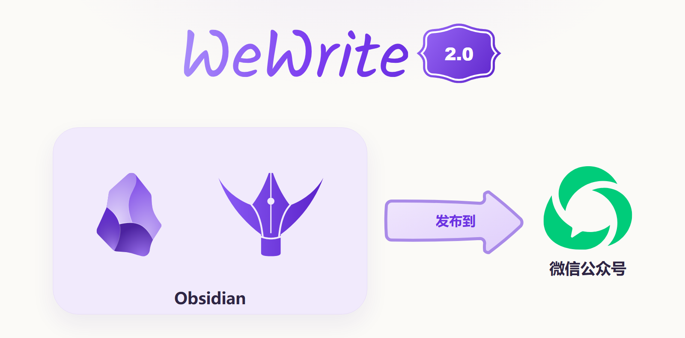

[English](README.md) | **简体中文**

> **关于语言**：Obsidian 社区目录始终读取仓库根目录的 `README.md`，且面向全球用户，
> 因此本仓库以英文版 [README.md](README.md) 为主；本文件是内容完整、同步维护的中文版。

# WeWrite — Obsidian 微信公众号写作插件

**在 Obsidian 中写笔记，一键渲染为公众号排版，推送到微信草稿箱。全平台可用，手机也能走完从写作到发布的整个流程。**

  
  
  

  

WeWrite 是社区插件，与 Obsidian / Dynalist Inc. 无隶属或代表关系；文中出现的产品名称与标志归各自权利人所有。

---

## 为什么选择 WeWrite 2.0

- **各平台功能一致。** 桌面端和移动端功能相同，主流设备上都能流畅运行；所有按钮不小于 44px，封面编辑器支持双指缩放和拖拽。
- **没有 CSS 文件。** WeWrite 走 Obsidian 原生渲染，发布时把所有样式内联进 HTML，微信不会丢掉你的排版。
- **你的数据属于你。** 图片直接上传到你的公众号素材库，不经过任何第三方。WeWrite 只发布到草稿箱，最终发送由你确认。
- **主题就是笔记。** 一个带 `wewrite_theme: true` 的 Markdown 笔记就是一套排版方案。可以从内置模板起步，在主题编辑器里实时预览改动。
- **100+ 元素装饰。** 标题、引用、代码块（12 种配色）、表格、列表、分割线、链接、公式、图表等，每一项都能单独定制。
- **重复发布快得多。** 每张图片都有一份 FNV1a-64 指纹，已经上传过的会自动跳过，改名或移动后依然能匹配。重复发布可以省下 90%+ 的时间。
- **三区封面编辑器。** 独立的封面比例任选，另外可以加一组 2.35:1 横版 + 1:1 方形，点一次**合成**就得到微信要的多比例裁剪图。三区都支持双指缩放、拖拽和裁剪，也都能交给 AI 生成。
- **内置 AI 写作助手。** 校对、同义词、翻译、Mermaid 与公式生成、文生图、摘要，都不必离开 Obsidian。

---

## 功能一览

### Markdown 渲染

日常用到的语法都支持：

- 标题 H1–H6、粗体、斜体、删除线、行内代码
- 代码块，可选深色或浅色配色、行号、macOS 红绿灯装饰
- 有序与无序列表、任务清单、表格、引用、Callout、分割线、脚注、外部链接

此外还有 LaTeX 数学公式（渲染为 MathJax SVG）、Mermaid 图表、Excalidraw 手绘、Wiki-link 笔记嵌入，以及 Obsidian、Iconize、Remix 注入笔记的行内图标。

**PDF 嵌入。** PDF++ 局部截图（`![[file.pdf#page=N&rect=x1,y1,x2,y2|图注]]`）和整页嵌入（`![[file.pdf#page=N]]`）会在发布时渲染成 PNG 并缓存。这一步用的是 Obsidian 内置的 PDF.js，不需要额外安装任何东西。

**Dataview。** `dataview`、`dataviewjs` 代码块以及行内 `$= ...` 会交给 Dataview 插件求值，再按主题渲染成文本，和手写 Markdown 一样。

**图片与表格。** 没有指定尺寸的图片会按自身像素比例填满正文栏，宽截图在手机上也能看清，不用手动改尺寸；自己指定过尺寸的图片（`![[photo.png|200x150]]`）保持原样。表格按内容自适应：窄表格居中，不紧贴左边；宽表格在正文里横向滚动，而不是把列挤窄、把英文单词折成两半。

### 笔记编辑与 AI 写作助手

所有操作都有四个入口：**命令面板**、编辑器右键的 **「WeWrite」二级菜单**、笔记右上角的 **「⋮」菜单**，以及移动端的**编辑器工具栏**。

**插入图片**

| 功能 | 说明 |
|------|------|
| 从仓库插入图片 | 用缩略图网格列出仓库中的全部图片，可以按文件夹筛选、按文件名过滤。Obsidian 自带的附件选择器只给出一串文件名，图片一多就没法用了。 |
| 从系统插入图片 | 调用设备自己的图片选择器，手机上就是相册。图片会先复制进仓库（写入「新附件的默认位置」设置指定的文件夹），遇到 Obsidian 不支持的格式会转成 PNG。 |

**AI 写作工具**

| 功能 | 说明 |
|------|------|
| 校对 | 中英文的错别字、语法、标点检测。结果是一份清单，你先看完再决定：每条按严重程度着色（错别字和标点红、语法橙、措辞蓝），点一下就跳到对应位置。原文里只标记真正改动的字符，建议也可以先编辑再接受。可以逐条接受或忽略，也可以一次处理同类剩余的全部；`←`/`→` 切换，`Enter` 接受。有选中文本时校对选中内容，否则校对整篇笔记。代码、Frontmatter、链接和 `$公式$` 不会交给模型，因此不会作为「修改建议」返回。 |
| 同义词 | 结合词语所在句子给出的同义表达。每条附有义项和用法说明，可以原地重新查找。 |
| 翻译 | 支持 10 种目标语言。代码、链接、公式、标签不会被翻译；译文若丢了其中一段，会在替换前告警。 |
| 生成 Mermaid | 描述 → Obsidian 兼容的图表。图表类型由你指定，不用模型猜；插入前做语法检查，不通过会自动带错重试一次。 |
| 生成公式 | 描述 → LaTeX，可选块级或行内。插入前用 Obsidian 自己的 MathJax 真编译一遍。 |
| 生成图片 | 文字描述 → AI 配图，插入到光标位置。 |
| 生成摘要 | 在推文视图里按微信规范生成摘要。 |

**AI 文本提供商：** OpenAI / OpenAI Compatible（DeepSeek、通义等）/ Anthropic / Gemini / Ollama（本地）/ OpenRouter。

**文生图提供商：** 阿里万相 Wan 2.6 / 阿里千问 Qwen-Image 3.0 / 字节 Seedream 5.0 / OpenAI DALL·E（阿里两家需要填写业务空间 ID）。

**尺寸自动适配：** 尺寸可以随便填（`1440*613`、`2K`、`1024x1024`……），WeWrite 会自动换算成各模型真正接受的约束。比如 Seedream 要求总像素 ≥2560×1440，宽高都是 64 的倍数。公众号横幅的比例因此可以直接出图。

### 发布流程

写作 → WeWrite 推文视图实时预览 → 设置标题、作者、摘要和封面 → 一键推送草稿箱 → 在手机「公众号助手」App 里确认发送。

### 图片消息（NewsPic）

独立的图片消息视图：最多 20 张图片加说明文字，支持拖拽排序、手机框滑动预览和裁剪。

### 素材管理

图片、图文草稿、图片草稿各占一个 Tab。可以同步、删除、下载到 Vault、复制 CDN 链接、设为封面。已发布文章还在引用的素材会被自动标记，不容易误删。

### 主题系统

主题就是一份带 `wewrite_theme: true` 的 Markdown 笔记，存放在 `wewrite/themes/`。10 个内置预设（简约 GitHub、经典微信、优雅衬线、纸感长文、网格文档、排版美学、清爽媒体、缤纷强调、温暖日常、暗黑科技）和 10 个可下载主题用的是同一套主题系统，所以内置主题同样会妆点每一个元素，包括标题、引用、标注、表格、分割线、列表、行内标记、图片、公式、Mermaid、Excalidraw，而不只是旧预设认得的那几项。主题向导一个对话框就能建好主题，可视化编辑器覆盖 100+ 装饰项及其参数。

另有两个**主题级**设置，一个值贯穿同类全部元素，不必逐条装饰去调：

- **垂直间距：** 每类块级元素一个外边距（引用、标注、表格、代码块、公式、Mermaid 图、Excalidraw 画布，以及图片）。密集的技术笔记因此有自己的节奏，不必继承各元素自带的间距。
- **图片滑动窗：** 开启后，没有被空行分隔的图片会合并成一行可横向滑动的图片，图片多的文章明显变短；空行仍然另起一行。默认关闭，内置主题和可下载主题各有一半开启。

内置十款，可下载十款，全都用同一套主题系统写成，所以你自己做的主题也是同一类东西。**[贡献一个主题](CONTRIBUTING_zh.md)** 只需要一份 Markdown 笔记，没有构建步骤，合并后所有用户都能下载到。

### 多端同步（实验性）

内置 WebDAV 同步。多设备共享一个 Vault，冲突用可视化界面解决，同步日志可以回滚。针对坚果云免费版做了配额自适应：自动暂停和恢复，笔记优先。

### 设置导入 / 导出

把全部设置导出为 JSON（含版本号），用于跨 Vault 迁移。首次启动会检测到 v1.x 旧设置，一键迁移。

---

## 安装

> 需要 **Obsidian 1.6.6 或更高版本**。插件调用了 1.6.6 才引入的 `FileManager.trashFile` API，更低版本无法运行。语言检测用的 `getLanguage()`（1.8.7 引入）加了 `requireApiVersion` 守卫，在 1.6.6–1.8.6 上会回退为英文。

在 Obsidian 社区插件市场搜索 **"WeWrite"**，安装并启用。

或手动安装：

1. 从 [Releases](https://github.com/learnerchen-forever/wewrite/releases) 下载最新版本
2. 解压到 `<vault>/.obsidian/plugins/wewrite/`
3. 重启 Obsidian，在设置里启用插件

---

## 快速开始

1. 在插件设置里配置公众号 **AppID / AppSecret**（把 IP 加入白名单，或启用「使用中心 Token 服务器」）
2. 打开任意 Markdown 笔记，**右键 → 「作为微信公众号推文」**
3. 在参数面板填写标题、作者、摘要，也可以让 AI 生成
4. 选一个主题预设，确认预览效果
5. 点击 **「发布到草稿箱」**
6. 打开手机「公众号助手」App，进入草稿箱，确认发送

> 详细步骤和常见问题见下方 [教程](#教程)。

---

## 教程

- [教程 1：快速开始 — 从笔记到公众号草稿](tutorials/01-quickstart.md)
- [教程 2：主题与排版定制](tutorials/02-theme-and-style.md)
- [教程 3：AI 辅助写作](tutorials/03-ai-writing-tools.md)
- [教程 4：封面与图片](tutorials/04-cover-and-images.md)
- [教程 5：素材管理与图片消息](tutorials/05-materials-and-newspic.md)
- [教程 6：多端同步与设置](tutorials/06-sync-and-settings.md)

> 教程目前为中文；英文功能总览见 [README.md](README.md)。

---

## 更新历史

> 每个版本具体改了什么，见 [CHANGELOG.md](CHANGELOG.md)。插件升级后会自动弹出「更新说明」，
> 也可以随时用命令面板里的 **「查看 WeWrite 更新内容」** 再次打开。

### v2.0（2026.8）

一次全面重构：移动优先架构、Obsidian 原生渲染 + 零 CSS 内联样式管线、主题笔记系统 + 100+ 装饰项、AI 写作助手（校对/同义词/翻译/Mermaid/公式/文生图/摘要）、统一 FNV1a-64 素材指纹库、三区封面编辑器、图片消息、WebDAV 多端同步、API Key 加密存储、设置导入/导出、v1.x 自动迁移。

- 2026.09.18 — 发布 2.0.21：
  - 38 枚图标按同一套 24 网格和笔画重绘成一个家族；6 处原本借用 Obsidian 图标表达 WeWrite 动作的地方，改用自绘图标。
  - 10 个内置主题重建在与可下载主题同一套系统上；主题新增每类元素的**垂直间距**和**图片滑动窗**开关。
  - 未指定尺寸的图片填满正文栏，表格按内容自适应。
  - 校对结果改为按严重程度着色的清单，覆盖整篇笔记，跳过代码、Frontmatter 和链接。
  - 翻译和图表/公式生成在替换文本前先做校验。
  - 文生图尺寸按各模型的真实约束自动适配。
  - 插图可以从仓库或设备相册选取。
  - 封面合成提速约 20 倍，产物从 48 MB 降到 3 MB PNG。
- 2026.09.15 — 发布 2.0.20：删除账号前先确认。插件在 Obsidian 1.6.6–1.8.6 上恢复加载。设置面板在窄屏或竖屏下改用手机版紧凑布局，并保持滚动位置。渲染和发布不再重复读取、重复哈希同一批图片。
- 2026.09.13 — 发布 2.0.19：全部命令补齐图标，可以在手机编辑器工具栏直接调用。引用样式回到各主题自己的强调色，同时修复了嵌套引用和未装饰引用。主题向导的引用预设改用当前的装饰 Schema。合并外部 PR [#28](https://github.com/learnerchen-forever/wewrite/pull/28)（Synology `app://` 图片路径、列表内行内公式、复制到微信前先上传图片）。新增「更新说明」弹窗，发布说明改由 `CHANGELOG.md` 统一生成。
- 2026.09.07 — 发布 2.0.18。
- 2026.09.04 — 发布 2.0.17。
- 2026.09.04 — 发布 2.0.16。
- 2026.09.03 — 发布 2.0.15。
- 2026.09.03 — 发布 2.0.14。
- 2026.08.29 — 发布 2.0.13。
- 2026.08.25 — 发布 2.0.12。
- 2026.08.19 — 发布 2.0.11。
- 2026.08.19 — 发布 2.0.10。
- 2026.08.19 — 发布 2.0.9。
- 2026.08.19 — 发布 2.0.8。
- 2026.08.19 — 发布 2.0.7。
- 2026.08.18 — 发布 2.0.6。
- 2026.08.17 — 新增 PDF 嵌入渲染（PDF++ 局部截图和整页，基于 Obsidian 内置 PDF.js，零体积）和 Dataview 查询支持（求值后按主题渲染成文本）。
- 2026.08.16 — 2.0.3：界面优化，文生图支持国内三家最新模型（Qwen-Image 3、Wan 2.7、Seedance 5.0）。
- 2026.06.29 — WeWrite 2.0 发布，支持全平台创作。

### v1.x 重要更新（2023）

- 2023.06.16 — 文章属性默认打开评论（采纳 geosmart 建议）
- 2023.06.16 — 修复暗色模式下预览界面白色不协调的问题（PR #4，感谢 bushnerd）
- 2023.06.16 — 新增渲染风格《爱范儿》，参考公众号「爱范儿」排版

> **v2.0 里不再适用的旧特性：**
> - CSS 文件 + `juice` 后置内联 → 改为零 CSS 内联渲染
> - IndexedDB 存储 → 改为 Obsidian 原生 API
> - 仅桌面端 → 现已支持全平台
> - 扁平主题预设 → 升级为层级化的主题笔记系统

---

## 致谢

本插件的开发深受以下项目启发：

1. [note-to-mp](https://github.com/sunbooshi/note-to-mp)
2. [obsidian-wechat-public-platform](https://github.com/ai-chen2050/obsidian-wechat-public-platform)
3. [obsidian-export-image](https://github.com/zhouhua/obsidian-export-image)
4. [marked.js](https://marked.js.org/)
5. [gray-matter](https://github.com/jonschlinkert/gray-matter)
6. [highlight.js](https://highlightjs.org/)
7. [MathJax](https://www.mathjax.org/)

感谢这些项目的开发者对开源社区的贡献。

---

## 许可证

[MIT](LICENSE)
