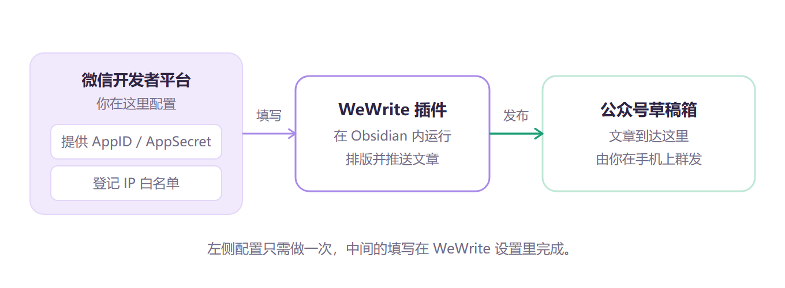
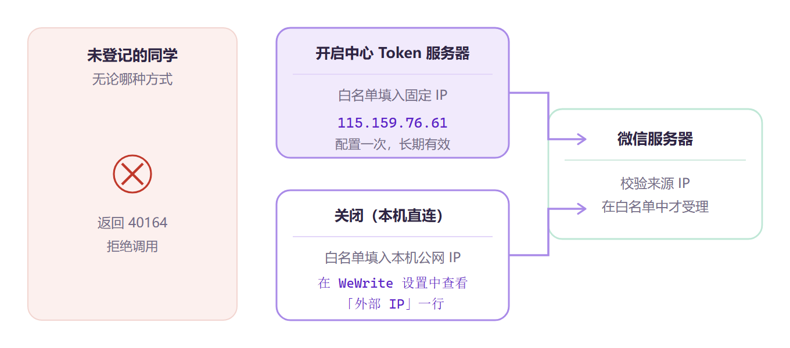
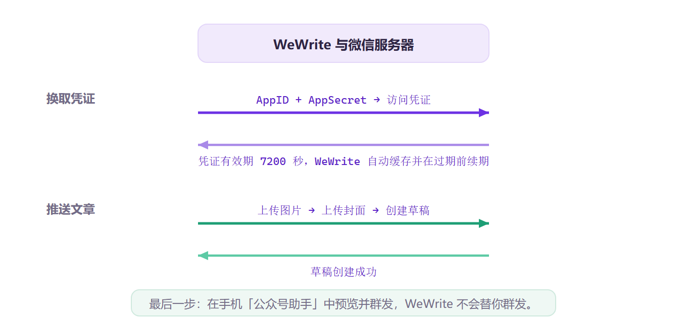

# 教程 7：公众号 API 鉴权与 IP 白名单

> WeWrite 连接公众号需要三项信息：AppID、AppSecret 和 IP 白名单。本教程说明这三项分别是什么、在哪里获取、如何配置，以及为什么少了 IP 白名单就连不上。不需要编程基础，按顺序操作即可。

---

## 目标

- 在微信开发者平台找到 AppID 与 AppSecret
- 理解 IP 白名单的作用，判断用哪种连接方式
- 在公众号后台配置好白名单
- 在 WeWrite 中填好账号并测试通过

## 一、WeWrite 需要你提供什么

WeWrite 把写在 Obsidian 里的笔记排版成公众号格式，再推送到你的公众号草稿箱。整个过程需要三项信息，全部由你提供。

| 需要的信息 | 作用 |
|------------|------|
| **AppID** | 公众号的唯一编号。相当于账号名，可以公开。 |
| **AppSecret** | 公众号的密钥。相当于密码，泄露等于把公众号交给别人。 |
| **IP 白名单** | 告诉微信哪些网络可以操作这个公众号。不配置就无法连接。 |

三项信息全部在**微信开发者平台**获取和配置，见第二节。配置完成后，WeWrite 才能发布文章。



> 图 1　WeWrite 依靠你提供的三项信息连接公众号，文章最终进入草稿箱。

## 二、在微信开发者平台获取配置信息

> [!info] 配置入口已迁移
> 公众号的开发配置（AppID、AppSecret、API IP 白名单）现在统一在**微信开发者平台**管理：`developers.weixin.qq.com/platform`。
> 旧地址 `mp.weixin.qq.com` 主要承担注册、认证、发文等运营功能，开发配置正在逐步迁出。本教程以开发者平台为准。

### 1. 登录开发者平台

电脑浏览器打开 `developers.weixin.qq.com/platform`，用公众号管理员或开发者的微信扫码登录。

只有公众号的管理员或已被添加为开发者，才能进入详情页。

### 2. 进入公众号详情页

顶部导航进入「我的业务」，在列表中选择你的公众号或服务号。

路径：`我的业务 → 公众号 / 服务号`

### 3. 在「基础信息」中查看 AppID

详情页默认打开「基础信息」Tab。「账号资料」区域显示 **AppID**，支持一键复制。

### 4. 查看或重置 AppSecret

同一 Tab 的「AppSecret 管理」区域，可执行启用、重置、冻结、解冻四种操作。AppSecret 默认隐藏，需要点击重置后查看。

> [!danger] AppSecret 重置后只完整显示一次
> 关闭页面后就无法再看到，只能再次重置。看到时立即存入密码管理器，不要留在聊天记录或截图里。
> 重置会让旧密钥立刻失效，如果之前已在别处使用，需要一并更新。

## 三、配置 IP 白名单

这一步不能跳过。微信会拒绝所有来自未登记网络的调用，包括 WeWrite 发出的。在下这个判断之前，需要先理解 WeWrite 的两种连接方式——它们要求的白名单内容不同。

### 两种连接方式

WeWrite 设置中有「**使用中心 Token 服务器**」开关，默认开启。两种方式的区别：

| 方式 | 白名单要填什么 | 说明 |
|------|----------------|------|
| **开启**（默认） | 固定 IP `115.159.76.61` | 由 WeWrite 的中心服务器代为获取凭证，地址固定，配置一次即可长期使用。 |
| **关闭** | 你当前设备的公网 IP | 由你的电脑或手机直接向微信请求凭证，不经过第三方。 |

> [!warning] 两种方式都必须配置白名单
> 无论开关处于哪一侧，都必须往白名单里填一个 IP，否则连接不成功。
> 开关只是决定「填哪个 IP」：开启填中心服务器的固定 IP，关闭填你设备当前的公网 IP。



> 图 2　两条路径都要登记白名单，区别只在于填哪个 IP。

### 如何选择

- **用固定网络**（家里或公司，网络长期不变）：两种方式都可以。关闭开关，把本机公网 IP 填进白名单，密钥不经过第三方。
- **经常切换网络**（笔记本、多地点办公）：建议保持开启。本机 IP 每变一次都要回后台改白名单，用固定 IP 省去这个麻烦。
- **在意密钥安全**：见下方说明后再决定。

> [!note] 关于中心 Token 服务器能看到什么
> 开启后，AppID 和 AppSecret 会经由 WeWrite 的中心服务器转发，**原理上该服务器可以看到这两个值**。
> 实现上它从不保存这两个值，仅用于当次换取凭证——但这是实现层面的承诺，不是技术上的不可能。
>
> **是否信任这个中心服务器，由你决定。**如果你不接受密钥经过任何第三方，就关闭该开关，自行解决本机 IP 的白名单问题。两种方式都能正常工作，区别只在取舍。

### 配置白名单的操作

1. **进入 IP 白名单页面**

   在微信开发者平台：`我的业务 → 公众号 / 服务号 → 基础信息 → API IP 白名单`

2. **填入 IP 地址**

   填入上一节确定的那个 IP：开启中心 Token 服务器填 `115.159.76.61`；关闭则填你的本机公网 IP。保存时可能需要管理员微信扫码确认。

3. **等待几分钟**

   白名单修改后需数分钟生效。刚保存就测试可能仍然失败，属于正常现象。

> [!warning] 关闭开关时，从哪里获取本机公网 IP
> WeWrite 设置页在「使用中心 Token 服务器」开关上方显示一行**「外部 IP：」**，后面跟着当前检测到的地址，右侧有「刷新」按钮。
> 点一下刷新，把这行显示的 IP 复制到白名单即可——不需要去别的网站查。
>
> 这个地址由运营商动态分配，重启光猫、切换网络后都可能变化。每次变化都要回后台更新白名单，这也是「经常切换网络建议用中心服务器」的原因。

> [!warning] 连接失败时，从提示中抄出 IP
> WeWrite 检测到未登记的网络时，会直接给出如下提示：
>
> ```
> IP 不在白名单中。
> invalid ip 203.0.113.45 ipv6 ::ffff:203.0.113.45, not in whitelist
>
> 操作：将您的 IP 添加到微信公众号后台：
> [设置与开发] → [基本配置] → [IP 白名单]
> ```
>
> `invalid ip` 后面那一串就是当前网络的出口 IP，复制填入白名单即可。

### 白名单的填写规则

- 可以填具体 IP，也可以填 IP 段，例如 `172.0.0.1`、`172.0.0.1/24`。
- 不支持 `172.0.0.*` 这种通配写法。
- 不支持「IP:端口」形式。
- 可以配置多条，两处 IP 都填上也可以。
- 修改后需等待数分钟生效。

## 四、在 WeWrite 中填写并测试

1. **打开 WeWrite 设置**

   在 Obsidian 左侧栏点击设置图标，找到 **WeWrite** 设置页。

2. **设置中心 Token 服务器开关**

   根据第三节的决定，确认「使用中心 Token 服务器」处于你需要的状态。保持开启则跳过白名单填写本机 IP 的步骤。

3. **添加公众号账号**

   在「**微信公众号账号**」分组中新增一条记录，依次填写：
   - **账号名称** —— 自己取一个便于辨认的名字，不影响发布。
   - **AppID** —— 从第二节复制。
   - **AppSecret** —— 从第二节复制。

4. **点击「测试连接」**

   WeWrite 会用填写的 AppID 和 AppSecret 向微信请求一次凭证。成功说明三项配置全部正确，失败则按提示修正。

5. **点击「设为启用」**

   该分组可以保存多个公众号。发布时使用标记为「启用」的那一个。



> 图 3　凭证由 WeWrite 自动获取和续期，你只需在发文时点击发布。

## 五、发布一篇文章

配置完成后，发布流程是固定的：

1. 在 Obsidian 中打开写好的笔记。
2. 按 `Ctrl+P`（macOS 为 `Cmd+P`）打开命令面板，执行「**打开微信公众号推文视图**」。
3. 在面板中填写标题、摘要（可选），选择排版主题，确认封面图。
4. 点击发布。WeWrite 依次完成渲染排版、上传正文图片、上传封面、创建草稿。
5. 提示发布成功后，打开手机上的「公众号助手」，在草稿箱中找到这篇文章，预览无误后群发。

> [!info] WeWrite 停在草稿箱，不替你群发
> 这是有意设计的。公众号群发次数有限，一次误触可能让当天无法再发。最后一步始终由你在手机上确认。

> [!warning] 封面图是发布的必需项
> 笔记中没有图片时，发布会提示「请在发布前合成或加载分区 C 的封面图片」。这是新手最常遇到的拦截。
> 在笔记中插入任意一张图片，或在推文视图中选择封面即可通过，详见 [教程 4：封面与图片](04-cover-and-images.md)。

## 六、常见错误与处理

| 提示 | 原因 | 处理 |
|------|------|------|
| **IP 不在白名单中**（`40164`） | 当前来源 IP 未登记 | 从提示中抄出 IP 加入白名单，等待数分钟。注意开启与关闭中心服务器时，要登记的 IP 不同。 |
| **不合法的 AppID**（`40013`） | AppID 填写有误 | 检查是否多复制了空格，大小写是否正确。 |
| **无效的 AppSecret**（`40125`） | 密钥错误或已被重置 | 回开发者平台重新查看；无法查看则重置后重新填写。 |
| **账号已冻结**（`40243`） | AppSecret 处于冻结状态 | 在开发者平台「AppSecret 管理」中解冻，操作后 10 分钟生效。 |
| **中心 Token 服务器错误** | 中心服务器暂时不可用 | 稍候重试；或在设置中关闭该开关，改用本机直连。 |
| **系统繁忙**（`-1`） | 微信服务器临时不可用 | 稍候重试，无需修改配置。 |
| **超过当日调用上限**（`45009`） | 接口调用次数用尽 | 次日自动恢复，或在开发者平台重置调用额度。 |

## 七、配置清单

配置一遍，逐项确认：

- [ ] 已登录 `developers.weixin.qq.com/platform`，在「我的业务」中找到公众号。
- [ ] 已从「基础信息」获取 **AppID** 和 **AppSecret**，并将 AppSecret 存入密码管理器。
- [ ] 已决定是否使用中心 Token 服务器。
- [ ] 已在「API IP 白名单」填入对应 IP：开启填 `115.159.76.61`，关闭填本机公网 IP。
- [ ] 白名单保存后已等待数分钟。
- [ ] 已在 WeWrite 设置的「微信公众号账号」中填好三项信息。
- [ ] 「测试连接」已通过。
- [ ] 该账号已点击「设为启用」。

---

## 常见问题

| 问题 | 解决 |
|------|------|
| 开启中心 Token 服务器后仍然提示 IP 不在白名单 | 开关不代表免配置。中心服务器的固定 IP `115.159.76.61` 同样要填进白名单。 |
| 换了网络就连不上 | 关闭开关时填的是本机公网 IP，它会随网络变化。重新读取「外部 IP」并更新白名单，或改用中心服务器。 |
| 在 mp.weixin.qq.com 找不到 AppSecret | 开发配置已迁到 `developers.weixin.qq.com/platform`，到「我的业务 → 公众号 → 基础信息」里找。 |
| AppSecret 忘了，也看不到 | 无法再次查看，只能重置。重置后旧密钥立即失效，记得同步更新其它用到的地方。 |

---

**下一步**：配置好账号后，回到 [教程 1：快速开始](01-quickstart.md) 发布第一篇文章。

<!-- 文中配置入口与错误码依据微信官方文档整理；中心 Token 服务器的固定 IP 与双通道行为依据 WeWrite 插件源码与实际运行结果。 -->
